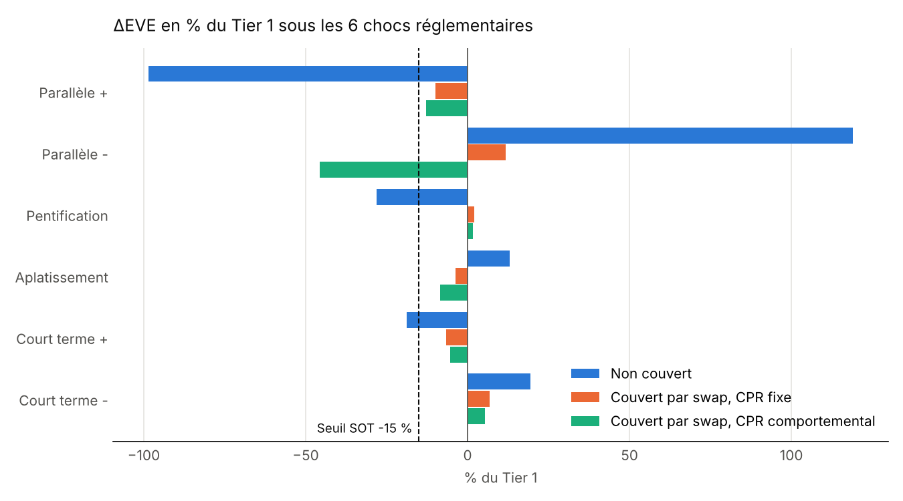
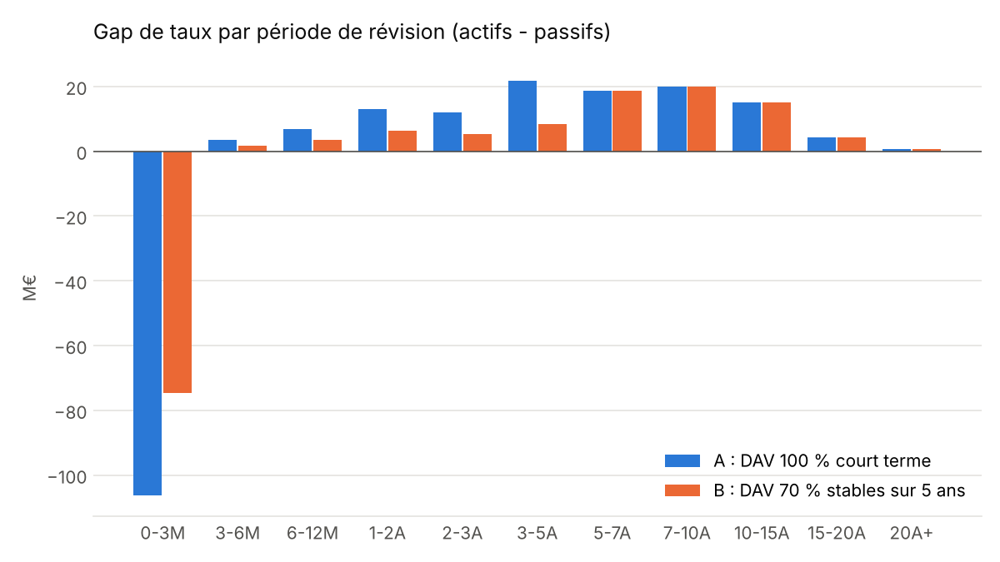
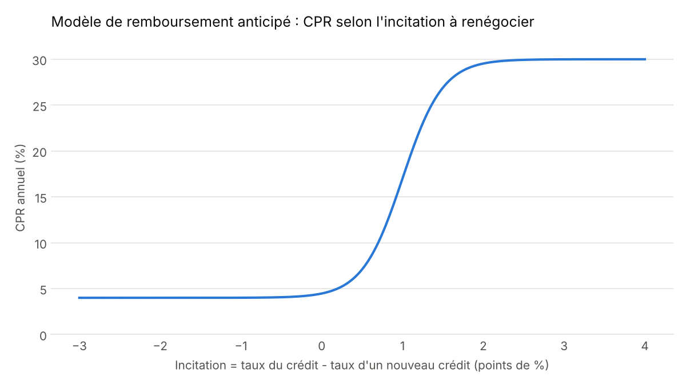

# Gestion actif-passif d'une banque de détail : mesure et couverture du risque de taux (IRRBB)

**Auteur :** Moussa FALL, M2 Banque Finance, Université Lumière Lyon 2
**Langage :** Python (numpy, pandas, matplotlib)

## Objectif

Modéliser le bilan simplifié d'une banque de détail qui prête à taux fixe (crédits immobiliers) et se finance à court terme, puis mesurer son risque de taux selon les deux angles réglementaires (marge nette d'intérêt et valeur économique des fonds propres) et tester une couverture par swap.

## Résultats clés

| Étape | Résultat |
|---|---|
| Écoulement | Un CPR de 10 % ramène la durée de vie moyenne de l'actif de 7,5 à 4,6 ans |
| Gap de taux | Gap de -75 M€ à 0-3 mois : la banque transforme (finance court, prête long) |
| MNI | Choc de +200 pb : -1,26 M€ sur la marge d'intérêt à 1 an |
| EVE | Choc parallèle de +200 pb : ΔEVE = **-99 % du Tier 1** (seuil d'alerte : -15 %) |
| Couverture | Swap payeur 10 ans de 52,5 M€ : ΔEVE ramenée à -10 % du Tier 1, pour un coût de portage de 0,40 M€/an |
| Convexité | Avec des remboursements anticipés dépendants des taux, **aucun nominal de swap** ne tient à la fois la hausse et la baisse des taux |



**Conclusion :** l'option de remboursement anticipé vendue aux emprunteurs crée une convexité négative. Un swap, instrument linéaire, ne peut pas la couvrir seul : la couverture doit inclure des instruments optionnels (swaptions receveuses par exemple).

## Méthode

1. **Portefeuille et échéancier.** 500 crédits fictifs à taux fixe (119 M€, taux moyen 2,54 %), échéancier mensuel à mensualités constantes, remboursements anticipés en CPR converti en taux mensuel : SMM = 1 - (1 - CPR)^(1/12).
2. **Gap de taux statique.** Actifs et passifs rangés par période de révision du taux. Les dépôts à vue, sans échéance contractuelle, suivent une convention d'écoulement (70 % stables écoulés sur 5 ans, 30 % volatils). Le gap cumulé final égale les fonds propres, exclus du calcul : contrôle de cohérence.
   
3. **ΔEVE sous les 6 chocs réglementaires** (parallèle +/-, pentification, aplatissement, court terme +/-), formules du Comité de Bâle, plancher post-choc de l'EBA, test des valeurs extrêmes à -15 % du Tier 1. Calibrages 2016 (200/250/100 pb) et 2024 (225/350/200 pb) comparés.
4. **Couverture par swap payeur.** La ΔEVE couverte étant linéaire en nominal, chaque scénario impose une borne : on obtient directement l'intervalle des nominaux admissibles pour chaque maturité de swap (5, 7, 10, 15 ans). Un swap trop court ou trop long ne permet pas de tenir les 6 scénarios.
5. **Remboursements anticipés comportementaux.** CPR modélisé par une courbe en S de l'incitation à renégocier (taux du crédit - taux d'un nouveau crédit). En baisse de taux, le CPR moyen passe de 4,9 % à 20,1 % et la banque couverte perd 46 % de son Tier 1.
   

## Hypothèses et limites

- Portefeuille **fictif** ; courbe des taux **illustrative** (pas de données de marché).
- Paramètres du modèle de remboursement anticipé **non calibrés** sur un historique réel.
- Bilan statique (pas de production nouvelle), courbe unique pour l'actualisation et la projection.
- MNI approchée par le gap de taux ; marges commerciales incluses dans l'actualisation de l'EVE.
- Tier 1 approché par les fonds propres du bilan simplifié.

## Pistes d'amélioration

- Remplacer la courbe illustrative par la courbe de la BCE (emprunts d'État AAA de la zone euro) ou une courbe €STR.
- Ajouter une swaption receveuse (modèle de Bachelier) et chercher la combinaison swap + option la moins coûteuse respectant les 6 scénarios.
- Couverture par plusieurs swaps de maturités différentes, calée sur le profil de gap.
- Calcul de la MNI en bilan dynamique sur 1 à 3 ans.

## Lancement

```bash
pip install numpy pandas matplotlib
python alm_irrbb.py
```

Le rapport s'affiche dans la console et les graphiques sont enregistrés dans `resultats/`. Tous les paramètres (structure du bilan, convention des dépôts à vue, CPR, seuils, calibrage) sont regroupés en tête du fichier dans `PARAMS`.

## Références

- Comité de Bâle, *Interest rate risk in the banking book* (2016), et recalibrage des chocs publié le 16 juillet 2024 (d578).
- EBA, normes techniques de réglementation sur les tests de valeurs extrêmes (SOT) en IRRBB.
